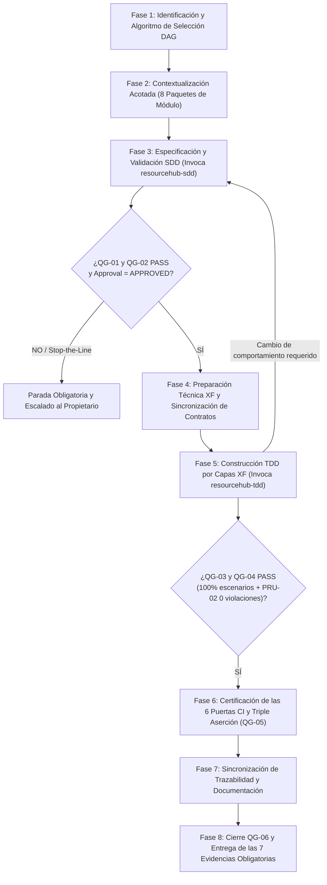

# SKILL: `resourcehub-development-workflow` — Orquestador del Flujo SDD + TDD en ResourceHub

| Metadato | Valor |
| :--- | :--- |
| **Identificador de SKILL** | `RH-SKILL-WORKFLOW` |
| **Nombre de activación** | `resourcehub-development-workflow` |
| **Versión de la SKILL** | `v1.1.0` |
| **Fecha de vigencia** | `2026-11-27` |
| **Ámbito** | Específica del proyecto **ResourceHub** (`.agents/skills/resourcehub-development-workflow/`) |
| **Estándares base (`APPROVED`)** | `ResourceHub — Flujo de Desarrollo SDD y TDD v1.0` (`RH-FLU-SDD-TDD-v1.0`), `Guía de Preparación para Desarrollo con Agentes v1.0` (`RH-GUI-AGE-v1.0`), `Backlog Técnico Implementable v1.0` (`RH-BACK-TEC-IMP-v1.0`), `Matriz de Dependencias del Backlog v1.0` (`RH-MAT-DEP-BACK-v1.0`), `DEC-099` (Flujo `develop` Preproducción → `main` Producción) |
| **SKILLs orquestadas** | `resourcehub-sdd` (especificación y `QG-01..02`), `resourcehub-tdd` (ciclo `RED -> GREEN -> REFACTOR` y `QG-03..05`), `xf-architecture` (`DTD-003`), `response-wrapper` (`DTD-007`), `document-version-management` (versionado en Google Drive) |
| **Recursos empaquetados** | [`references/context-packages-and-gates.md`](references/context-packages-and-gates.md) |

---

## 1. Objetivo

Esta SKILL es el **punto de entrada metodológico obligatorio y coordinador maestro** para todo agente de IA que participe en el desarrollo de ResourceHub. Su misión es gobernar de principio a fin la ejecución de las unidades de trabajo del `Backlog Técnico Implementable v1.0` (`3 INI`, `15 EP`, `48 FUN`, `52 HU`, `106 TT`), asegurando que:

1. Ningún agente elija arbitrariamente una tarea ni lea indiscriminadamente los 25 documentos del proyecto.
2. Se respete el algoritmo determinista de selección del DAG (`RH-GUI-AGE-v1.0 §2`) y los estados tridimensionales del backlog (`Approval`, `Definition`, `Execution`).
3. Se activen en el momento exacto las SKILLs especializadas **`resourcehub-sdd`** (para especificar y validar `QG-01` / `QG-02`) y **`resourcehub-tdd`** (para construir mediante `RED -> GREEN -> REFACTOR` sobre capas XF y certificar `QG-03` / `QG-04` / `QG-05`), junto con **`xf-architecture`** y **`response-wrapper`**.
4. Se detenga inmediatamente la línea (*Stop-the-Line*) ante cualquiera de las **8 condiciones de bloqueo obligatorio (`STL-01..08`)** sin tomar decisiones que corresponden al propietario del proyecto.
5. Ninguna tarea se declare `DONE` sin entregar las **7 evidencias verificables de cierre (`QG-06`)**.

---

## 2. Condiciones de Activación

Activa `resourcehub-development-workflow` como **SKILL primaria** en cualquiera de los siguientes escenarios:

1. **Selección o inicio de trabajo del backlog:** Cuando se solicite iniciar una `TT-*`, `HU-*`, `FUN-*`, `EP-*` o `INI-*`, o determinar cuál es la siguiente unidad de trabajo ejecutable en el camino crítico o en carriles paralelos del MVP activo.
2. **Ciclo completo de desarrollo (*End-to-End Task Execution*):** Cuando una petición requiera pasar desde la revisión contextual y especificación SDD hasta la implementación TDD, verificación de las 6 puertas de CI y cierre de la tarea.
3. **Coordinación de cambios *Spec-First* o gestión de bloqueos:** Cuando durante la ejecución de `resourcehub-tdd` surja la necesidad de modificar un contrato, una tabla (`PCR-DAT-*`), un código `FFMMCC` (`DTD-011`) o escalar una ambigüedad `BLOCKER`/`HIGH`.
4. **Certificación de cierre de tarea o hito (`QG-06`):** Cuando se pida auditar el estado de avance del backlog o validar las 7 evidencias de cierre de una unidad de trabajo o entrega `MVP-*` (`HITO-01..08`).

---

## 3. Flujo Operativo Completo en 8 Fases

Todo agente que ejecute una unidad de trabajo en ResourceHub debe recorrer secuencialmente las **Fases 1 a 8**, respetando las puertas de control `QG-01` a `QG-06`:



### Fase 1 — Identificación del Trabajo y Algoritmo Determinista de Selección (`RH-GUI-AGE-v1.0 §2`)

1. Consulta la unidad solicitada (`TT-001..106`, `HU-001..052`, `FUN-001..048`) en `Backlog Técnico Implementable v1.0.md` y en `Matriz de Dependencias del Backlog v1.0.md`.
2. Comprueba sus **3 dimensiones de estado** (ver tabla completa en [`references/context-packages-and-gates.md`](references/context-packages-and-gates.md)):
   - **`Approval`:** ¿Está en `APPROVED`? Si está en `READY_FOR_REVIEW` o `DRAFT`, **PARADA**: está prohibido implementar elementos no aprobados por el propietario.
   - **`Execution` de dependencias previas:** ¿Están todas sus `TT-*` predecesoras en `Execution = DONE`? Si no lo están, informa del bloqueo por dependencia (`BLOCKED_BY_DEPENDENCY`) y selecciona primero la dependencia previa en el Camino Crítico o Carril Paralelo.
   - **`Definition` y Entry Gates (`MRD-007`):** Si tiene `Definition = NEEDS_CLARIFICATION` asociado a una cuestión `OPEN-*` de Nivel 2, verifica en Fase 3 si el propietario confirmó el Gate o autorizó aplicar el valor por defecto aprobado en `MRD-007`.
   - **Modo de paralelismo (`INDEPENDIENTE` vs `COORDINADA`):** Si es `COORDINADA`, bloquea/sincroniza primero el contrato compartido (firma en `B.*`, evento o `ErrorCode` ENUM) antes de codificar.

### Fase 2 — Contextualización Acotada por Módulo (Cero Lectura Indiscriminada, `RH-GUI-AGE-v1.0 §3`)

1. Identifica a cuál de las **8 agrupaciones modulares** pertenece la tarea (`MOD-11 + COMP-GW`, `MOD-01`, `MOD-02`, `MOD-03..04`, `MOD-05`, `MOD-06..08`, `MOD-09..10`, o `EXP-01..02`).
2. Carga **únicamente el Paquete Transversal Obligatorio (5 artefactos) + las Secciones Específicas del Módulo** detalladas en [`references/context-packages-and-gates.md`](references/context-packages-and-gates.md), omitiendo explícitamente los documentos que la matriz marca como innecesarios para ese módulo.
3. Mantén activas durante toda la tarea las reglas de `.agents/skills/xf-architecture/SKILL.md` (`DTD-003`) y `.agents/skills/response-wrapper/SKILL.md` (`DTD-007`).

### Fase 3 — Validación y/o Elaboración SDD (Delega en [`resourcehub-sdd`](../resourcehub-sdd/SKILL.md))

1. **Invoca la SKILL `resourcehub-sdd`** sobre la ficha `SPEC-<MOD>-<NNN>` asociada a la tarea en `Catálogo de Especificaciones de Implementación v1.0.md`.
2. Verifica o completa las **15 secciones oficiales** de la `SPEC-<MOD>-<NNN>`.
3. Evalúa las puertas de calidad **`QG-01`** y **`QG-02`**:
   - Si se detecta cualquiera de las 8 condiciones *Stop-the-Line* (Sección 5), detén el flujo de la tarea activa y escala al propietario con el formato estándar.
   - Si `QG-01` y `QG-02` son `PASS`, transiciona la tarea a `Execution = READY_FOR_DEVELOPMENT` y avanza a la Fase 4.

### Fase 4 — Preparación Técnica sobre la Arquitectura XF y Rama de Trabajo (`DEC-099`)

1. **Creación obligatoria de rama conforme al flujo de entornos (`develop` = Preproducción, `main` = Producción):**
   - **Todo desarrollo normal** (`feat/TT-XXX-<slug>`, `fix/*`, `spec/*`, `chore/*`, `refactor/*`, `test/*`) debe crearse **siempre desde `develop`** y su Pull Request debe abrirse **siempre hacia `develop`** (entorno estable de **Preproducción**).
   - **Única excepción (`hotfix/*`):** Solo una corrección urgente en Producción se crea desde `main` (o tag `v*`) con PR hacia `main`, exigiendo un **backmerge obligatorio posterior hacia `develop`**.
   - **Prohibido abrir PRs de funcionalidades/tareas directamente contra `main`.** La promoción a **`main` (Producción)** se realiza exclusivamente desde **`develop`** tras superar CI/CD (`ci-develop.yml`) y las validaciones acordes de Preproducción.
2. Verifica el **Pre-Flight Checklist de 8 pasos** de `resourcehub-tdd`:
   - Identificación exacta de los artefactos a tocar en las **3 capas cerradas XF** (`repository/logic/*Repository` vía `R`, `business/logic/*Business` vía `B`, `api/logic/services/*Service` o `api/logic/gui/*View` vía `A`) y en los **5 tipos cerrados XF** (`logic/`, `base/`, `R`/`B`/`A`/`XF`, `utils/*Utils`, `structs/` sin sufijos `DTO`/`Entity`/`Model` + `*Exception`).
   - Confirmación del host (`platform.resourcehub.app` vs `{orgSlug}.resourcehub.app`), prefijo de canal (`/app`, `/workspace`, `/console`, `/external`, `/webhooks/inbound`) y valores `ErrorCode` ENUM (`MOD-11`) declarados en la `SPEC-*`.
3. Transiciona la unidad de trabajo a `Execution = IN_PROGRESS`.

### Fase 5 — Implementación Guiada por Pruebas (Delega en [`resourcehub-tdd`](../resourcehub-tdd/SKILL.md))

1. **Invoca la SKILL `resourcehub-tdd`** para implementar iterativamente cada escenario *Given / When / Then* de la Sección 14 de la `SPEC-<MOD>-<NNN>`.
2. Exige en cada iteración:
   - **`RED` (`QG-03`):** Test escrito primero que falla por la aserción funcional exacta (`0` falso RED).
   - **`GREEN`:** Código mínimo implementado en orden XF (`repository` → `business` → `api` → `COMP-GW`), donde los módulos `MOD-01..10` solo emiten `ErrorCode` ENUM simbólico y solo `COMP-GW` traduce a `numeric_value` (`FFMMCC`) en `ResponseWrapper<T>`.
   - **`REFACTOR`:** Limpieza de diseño y ejecución de `PRU-02` (**8 Reglas ResourceHub + 50 Reglas XF**) con `0 violaciones`.
3. **Retorno obligatorio *Spec-First*:** Si durante la Fase 5 se descubre que falta un código de error, un campo o una regla en la `SPEC-<MOD>-<NNN>`, **suspende inmediatamente la Fase 5 y regresa a la Fase 3 (`resourcehub-sdd`)**.
4. Confirma **`QG-04`** cuando no queden escenarios pendientes en la `SPEC-*` y la cobertura de ramas en `business/logic` sea **≥ 90%**.

### Fase 6 — Certificación de las 6 Puertas de CI, Flujo de Ramas y No Regresión (`QG-05`)

1. Verifica la política de ramas (`./scripts/validate-branch-flow.sh <base> <head>`) y ejecuta las **6 Puertas de CI** definidas en `RH-DIS-TEC-v1.0 §6.2` y `RH-FLU-SDD-TDD-v1.0 §1`:
   - **Puerta 1:** Compilación estática y tipado estricto.
   - **Puerta 2:** `PRU-02` (`ArchUnit` + **8 Reglas ResourceHub + 50 Reglas XF** = `0 violaciones`).
   - **Puerta 3:** `PRU-01` (Unitarias de negocio `28 RN`, `Clock` inyectable, `0 mocks`, cobertura `≥ 90%`).
   - **Puerta 4:** `PRU-03`, `PRU-05`, `PRU-09` sobre **`Testcontainers PostgreSQL 16+` real** (migraciones Flyway `platform` y `org`, **sincronización 1:1 `ErrorCode <-> platform_catalog.error_catalog`**, `EXCLUDE USING gist`, `ltree`, triggers *append-only*, `REQUIRES_NEW`, Outbox `SKIP LOCKED`, concurrencia multihilo y **Triple Aserción**).
   - **Puerta 5:** `PRU-04`, `PRU-07`, `PRU-08` (suite de 9 puntos de `ResponseWrapper<T>` + `X-Request-Id`, seguridad `PRU-SEG-01..10`, ámbitos en `COMP-GW`, *PII Vault* `0 bytes PII` tras borrado RGPD y aislamiento multi-tenant sobre 2 BDs físicas).
   - **Puerta 6:** `PRU-06`, `PRU-10`, `PRU-11` (aceptación API/UI, resiliencia/reembolso compensatorio 100% y no regresión acumulada según el MVP activo).
2. Si cualquiera de las puertas falla, regresa a la Fase 5 (`resourcehub-tdd`) o a la Fase 3 (`resourcehub-sdd` si es problema de especificación). Prohibido avanzar con una puerta en rojo.

### Fase 7 — Revisión de Trazabilidad y Gestión Documental

1. Verifica que la ficha `SPEC-<MOD>-<NNN>` puede marcarse como `IMPLEMENTED` y que las referencias en `Matriz de Trazabilidad Técnica` / `Matriz de Trazabilidad del Backlog` están sincronizadas.
2. Si se ha generado o actualizado cualquier documento del proyecto en Google Drive:
   - Aplica `.agents/skills/document-version-management/SKILL.md`.
   - Mantén todo documento nuevo o modificado en estado `UNDER REVIEW` hasta que el usuario lo apruebe explícitamente (jamás muevas versiones anteriores a `@old/` antes de recibir la aprobación explícita del usuario).

### Fase 8 — Finalización, Pull Request hacia `develop`, Quality Gate `QG-06` y Promoción a `main`

1. Abre la Pull Request de la rama de trabajo hacia **`develop` (Preproducción)** (o hacia `main` únicamente si se trata de un `hotfix/*` productivo) utilizando `.github/pull_request_template.md` y espera la luz verde de `ci-pr.yml`.
2. Verifica el cumplimiento de **`QG-06`** y presenta al usuario el informe estandarizado de cierre con las **7 evidencias obligatorias** (Sección 7).
3. Tras la aprobación y fusión en `develop`, `ci-develop.yml` certifica el entorno de Preproducción. La promoción a **`main` (Producción)** se efectúa mediante PR dedicada `develop -> main` una vez superadas las validaciones de Preproducción (y al completar un `MVP-*` / `HITO-01..08`).

---

## 4. Matriz de Activación y Coordinación entre SKILLs

| Escenario / Petición de Trabajo | SKILL Coordinadora | Secuencia de Ejecución de SKILLs | Puertas Exigidas |
| :--- | :--- | :--- | :--- |
| **A. Especificar o auditar una `SPEC-<MOD>-<NNN>` sin codificar** | `resourcehub-development-workflow` (Fases 1–3) | `resourcehub-sdd` + `xf-architecture` + `response-wrapper` | `QG-01`, `QG-02` |
| **B. Implementar una `TT-*` / `HU-*` con `SPEC-*` ya `APPROVED`** | `resourcehub-development-workflow` (Fases 1–8) | `resourcehub-sdd` (check `QG-01..02`) → `xf-architecture` + `response-wrapper` → `resourcehub-tdd` (`RED -> GREEN -> REFACTOR` + 6 puertas CI) → PR a `develop` | `QG-01` a `QG-06` |
| **C. Abordar una `FUN-*` / `HU-*` que requiere redactar o ampliar su `SPEC-*` e implementarla** | `resourcehub-development-workflow` (Fases 1–8) | `resourcehub-sdd` (15 secciones; parada si requiere aprobación humana) → `resourcehub-tdd` → PR a `develop` | `QG-01` a `QG-06` |
| **D. Corregir un defecto o regresión (*Bugfix* / *Hotfix*)** | `resourcehub-development-workflow` | `resourcehub-sdd` (confirmar comportamiento esperado en `SPEC-*`) → `resourcehub-tdd` (test en `RED` → fix en `GREEN` → `REFACTOR` + `PRU-02`) → PR a `develop` (o `hotfix/* -> main` + backmerge a `develop`) | `QG-03` a `QG-06` |
| **E. Refactorizar componentes internos XF sin cambiar contratos** | `resourcehub-development-workflow` | `resourcehub-sdd` (confirmar invariancia de contrato) → `xf-architecture` → `resourcehub-tdd` (suite en `GREEN` + refactor + `PRU-02` `0 violaciones`) → PR a `develop` | `QG-04` a `QG-06` |
| **F. Añadir tabla/columna (`PCR-DAT-*`), nuevo código `FFMMCC` (`DTD-011`) o cambiar contrato** | `resourcehub-development-workflow` (*Spec-First Change*) | `resourcehub-sdd` (protocolo de cambio + **Stop-the-Line para aprobación humana**) → `document-version-management` → `resourcehub-tdd` → PR a `develop` | `QG-01` a `QG-06` (con parada humana obligatoria) |

---

## 5. Protocolo de Parada Obligatoria (*Stop-the-Line*, `RH-GUI-AGE-v1.0 §5`)

### 5.1. Las 8 Condiciones Innegociables de *Stop-the-Line* (`STL-01` a `STL-08`)

El agente **detendrá inmediatamente la codificación de la unidad activa** y escalará al propietario del proyecto cuando detecte cualquiera de las siguientes 8 condiciones:

1. **`STL-01` (Modificación del Modelo Físico de Datos):** Necesidad de añadir o modificar una tabla o columna del `Modelo Físico de Datos v1.1` (`34 tablas` en `11 esquemas`), lo cual exige presentar una propuesta formal `PCR-DAT-*` y esperar aprobación humana.
2. **`STL-02` (Nuevo código de error fuera del catálogo aprobado):** Necesidad de crear un código de error no incluido en los 34 códigos aprobados de `RH-ESP-INT-CON-v1.0 §3`, lo cual exige aplicar el protocolo de 4 pasos de `DTD-011` y solicitar aprobación humana.
3. **`STL-03` (Alteración del contrato `ResponseWrapper<T>`):** Necesidad de alterar cualquier campo del sobre cerrado `ResponseWrapper<T>` o `ErrorDetail` (`.agents/skills/response-wrapper/SKILL.md`).
4. **`STL-04` (Violación del DAG de dependencias modulares):** Necesidad de añadir una dependencia entre módulos no permitida por el DAG acíclico de `RH-DIS-TEC-v1.0 §4` (o de incumplir cualquiera de las 8 reglas ResourceHub / 50 reglas XF).
5. **`STL-05` (Contradicción documental jerárquica):** Contradicción entre documentos `APPROVED` de igual o distinto nivel en la jerarquía documental de 9 niveles.
6. **`STL-06` (Ambigüedad funcional `BLOCKER`/`HIGH`):** Ambigüedad funcional o hueco de negocio no cubierto por las `28 RN` ni por los valores por defecto aprobados en `MRD-007`.
7. **`STL-07` (Conflicto con requisito aprobado en regresión):** Fallo en una prueba existente de regresión cuya resolución obligaría a cambiar el comportamiento de un requisito `APPROVED`.
8. **`STL-08` (Cierre de Hito `HITO-01..08` / Gate `QG-06`):** Finalización de todas las tareas de un hito o entrega `MVP-*` (o intento de implementar un elemento cuyo estado es `Approval != APPROVED` o cuyas dependencias `TT-*` previas no están en `DONE`).

### 5.2. Regla de No Bloqueo Global y Formato Estándar de Escalado

- **Continuidad selectiva:** Si el usuario asignó un conjunto de tareas y una de ellas entra en *Stop-the-Line*, bloquea únicamente la `TT-*` afectada (y sus dependientes directas en el DAG) e indica qué otras `TT-*` independientes con dependencias en `DONE` pueden ejecutarse sin riesgo.
- **Formato obligatorio para solicitar aclaraciones al propietario (`RH-GUI-AGE-v1.0 §5.2`):**

```markdown
## Solicitud de Aclaración / Parada Stop-the-Line (`<STL-0X>`)
- **ID Unidad Afectada:** `<TT-XXX / HU-XXX / FUN-XXX>`
- **Especificación `SPEC-*` Afectada:** `<SPEC-MOD-NNN>`
- **Severidad:** `BLOCKER` | `HIGH` | `MEDIUM` | `LOW`
- **Fuentes Consultadas:** `[Documentos exactos de la jerarquía de 9 niveles y secciones verificadas]`
- **Descripción del Conflicto o Vacío:** `[Explicación precisa y citas documentales]`
- **Opciones Técnicas Viables:**
  1. **(Recomendada) Opción A:** `[Descripción + justificación arquitectónica]`
  2. **Opción B:** `[Descripción + pros/contras]`
- **Impacto en Modelo de Datos / Contratos / Backlog:** `[Tablas, endpoints, códigos FFMMCC o tareas TT-* dependientes afectadas]`
```

---

## 6. Límites de Autonomía del Agente

| Acciones Autorizadas (Autonomía del Agente) | Acciones Prohibidas sin Aprobación Humana Expresa |
| :--- | :--- |
| Aplicar el algoritmo de selección del DAG para identificar la siguiente `TT-*` con `Approval = APPROVED` y dependencias en `DONE`. | Implementar tareas con `Approval = DRAFT` / `READY_FOR_REVIEW` o con dependencias `TT-*` previas pendientes. |
| Crear ramas de trabajo desde `develop` y abrir Pull Requests hacia **`develop` (Preproducción)** tras pasar las puertas de calidad. | Abrir PRs de desarrollo (`feat/*`, `fix/*`, `chore/*`, `spec/*`) directamente contra **`main` (Producción)** o promocionar `develop -> main` sin validación y aprobación humana. |
| Cargar el paquete de lectura acotada del módulo y redactar las 15 secciones de `SPEC-<MOD>-<NNN>` derivadas de la baseline `APPROVED`. | Modificar unilateralmente documentos `APPROVED`, auto-aprobar borradores `UNDER REVIEW` o mover archivos a `@old/` sin orden del usuario. |
| Aplicar valores por defecto aprobados en `MRD-007` para cuestiones `OPEN-*` de Nivel 2, dejándolos documentados en la Sección 15 de la `SPEC-*`. | Resolver por cuenta propia cuestiones `BLOCKER`/`HIGH`, contradicciones documentales o inventar reglas de negocio no escritas. |
| Implementar componentes en las 3 capas y 5 tipos cerrados XF y ejecutar ciclos `RED -> GREEN -> REFACTOR` en `Testcontainers PostgreSQL 16+`. | Añadir tablas/columnas sin `PCR-DAT-*` aprobada, crear códigos fuera de los 34 `FFMMCC` sin el flujo `DTD-011`, o usar números mágicos en módulos. |
| Configurar parámetros por entorno permitidos (`RH-FLU-SDD-TDD-v1.0 §3.2`: TTL LRU de `TenantConnectionRouter`, TTL caché `error_catalog` en `COMP-GW`, perfiles Redis/Kafka). | Desactivar tests (`@Disabled`), usar H2/mocks en lugar de PostgreSQL 16+ real, saltar capas XF o exponer `application/problem+json` al exterior. |

---

## 7. Las 7 Evidencias Obligatorias de Cierre de Tarea (`QG-06`, `RH-GUI-AGE-v1.0 §5.2`)

Al informar del cierre de cualquier Tarea Técnica (`TT-*`) o Historia de Usuario (`HU-*`), el agente **debe presentar siempre la ficha de cierre con estas 7 evidencias verificables**:

```markdown
## Informe de Cierre de Unidad de Trabajo (`QG-06`) — `<TT-XXX>` (`<HU-XXX>`)

1. **Evidencia 1 — Especificación `SPEC-<MOD>-<NNN>` Verificada (`QG-01` y `QG-02`):**
   - Ficha `SPEC-<MOD>-<NNN>` completa en sus 15 secciones, trazada a `RF`/`RNF`/`CU`/`RN` y con estado `IMPLEMENTED`.
2. **Evidencia 2 — Ciclos `RED -> GREEN -> REFACTOR` en `Testcontainers PostgreSQL 16+` (`QG-03`):**
   - Relación de tests creados y ejecutados primero en `RED` (por aserción funcional) y luego en `GREEN` siguiendo el orden XF (`repository` -> `business` -> `api` -> `COMP-GW`).
3. **Evidencia 3 — Resultado de la Triple Aserción (`PRU-03` / `PRU-04` / `PRU-05`):**
   - (a) Contrato exterior `ResponseWrapper<T>` (`code` `FFMMCC`, `requestId == X-Request-Id`, `timestamp` UTC) y RFC 9457 interno con `ErrorCode` ENUM;
   - (b) Estado exacto verificado en tablas de PostgreSQL 16+ (y rollback íntegro en casos KO);
   - (c) Trazabilidad en `reservations.reservation_history`, asiento en `traceability.audit_logs` (`REQUIRES_NEW`, `0 PII`) y evento en `events.outbox_events` (`schemaVersion`, `0 PII`).
4. **Evidencia 4 — Conformidad Arquitectónica Doble en `PRU-02` (`QG-04`):**
   - Resultado `0 violaciones` en las **8 Reglas Arquitectónicas de ResourceHub (`RNF-MANT-001`)** y en las **50 Reglas de Conformidad XF (`DTD-003`)**, incluyendo `0` códigos numéricos mágicos en módulos de negocio.
5. **Evidencia 5 — Cobertura de Escenarios *Given / When / Then* y Ramas de Negocio (`QG-04`):**
   - 100% de escenarios positivos, borde y negativos de la Sección 14 de la `SPEC-*` en verde y cobertura de ramas lógicas `≥ 90%` en `business/logic/*Business`.
6. **Evidencia 6 — Pruebas de Seguridad, Ámbitos, Multi-Tenancy y Catálogo `FFMMCC` (`QG-05`):**
   - Resultado `PASS` en sincronización 1:1 `ErrorCode <-> platform_catalog.error_catalog` (`PRU-03`), escenarios `PRU-SEG-01..10` aplicables (`PRU-07`), aislamiento multi-tenant `404` `300001` (`PRU-08`) y concurrencia GiST/bloqueo canónico (`PRU-09`).
7. **Evidencia 7 — Estado Actualizado en Backlog y Matrices:**
   - Transición registrada: `Approval = APPROVED` | `Definition = SPECIFIED` | `Execution = DONE`, con `0` regresiones en la suite acumulada.
```

---

## 8. Versionado y Mantenimiento de la SKILL

- **Versión actual:** `v1.0.0` (sincronizada con `RH-FLU-SDD-TDD-v1.0`, `RH-GUI-AGE-v1.0` y `RH-BACK-TEC-IMP-v1.0`).
- **Regla de evolución (`DTD-015`):** Cualquier actualización aprobada sobre el `Flujo de Desarrollo SDD y TDD`, la `Guía de Preparación para Desarrollo con Agentes` o las SKILLs subordinadas (`resourcehub-sdd`, `resourcehub-tdd`, `xf-architecture`, `response-wrapper`) requiere actualizar sincronizadamente esta SKILL y su archivo [`references/context-packages-and-gates.md`](references/context-packages-and-gates.md).
